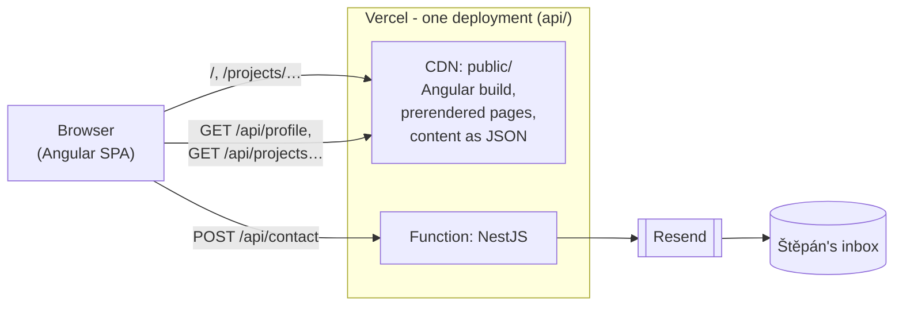
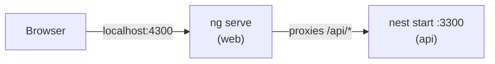

# 🏛️ Architecture

Two projects share this repository: an Angular single-page app, [`web`](./web/README.md), and a
NestJS app, [`api`](./api/README.md). In development they run as two servers; in production they
are **one Vercel deployment** - static files for the Angular build and the content, and the NestJS
app as one function for the contact form - so the frontend and the API share an origin and there
is no CORS.

This file is an index. Anything specific to a project lives in that project's `README.md`.

## 🗺️ How it fits together

### In production

- `npm run build` builds the Angular app, copies it into `api/public/`
  ([`copy-web.mjs`](./api/scripts/copy-web.mjs)), compiles the NestJS app and has it write the
  pages and content files below. Vercel runs the same build, with the commands in
  [`api/vercel.json`](./api/vercel.json).
- Vercel's CDN serves every file in `public/` as is, and a file always wins. The rest are
  rewrites in `vercel.json`, tried in this order: the content endpoints get their files, any
  other `/api/*` request goes to the function that runs the NestJS app, and any other path falls
  back to `index.html`, so the Angular router handles deep links after a refresh.
- `/` and `/projects/:slug` are files too: the build writes that same `index.html` once per page,
  with the page's title, description and link-preview image filled in - LinkedIn and chat apps
  don't run the Angular app, so they only see what the HTML says
  ([details](./api/README.md#️-how-its-wired)).
- **Content is static.** The profile and projects come from
  [`portfolio.ts`](./api/src/lib/portfolio.ts); changing them takes a commit and a deploy. Nothing
  is stored at runtime. The build writes what `GET /api/profile`, `/api/projects` and
  `/api/projects/:slug` answer into `public/api/` as `.json` files, so the page shows its content
  without the function having to start.
- **The contact form is the only dynamic part**, and with the `404`s for unknown API paths the
  only thing the function serves. It emails each message to Štěpán through
  [Resend](https://resend.com) and keeps no copy.

### In development

[`web/proxy.conf.json`](./web/proxy.conf.json) forwards `/api` to the NestJS dev server, so the
browser talks to one origin, as in production, and the frontend's `API_BASE_URL` stays `/api` in
both.

## 📦 Projects

| Project                  | Runs on            | Built with                                         | Tests                       |
| :----------------------- | :----------------- | :------------------------------------------------- | :-------------------------- |
| [`web`](./web/README.md) | the browser        | Angular 22 (zoneless, signals, Signal Forms), SCSS | Vitest in jsdom (`ng test`) |
| [`api`](./api/README.md) | Node.js, on Vercel | NestJS 12 (Express), zod, Resend                   | Vitest in Node              |

The API contract - `Profile`, `Project`, the contact request and its error codes - is defined in
`api/src/lib/` and copied by hand into
[`web/src/app/core/models.ts`](./web/src/app/core/models.ts).

## ⚙️ Tech stack

### 🖥️ Frontend

- [Angular](https://angular.dev) - standalone components, signals, `httpResource`,
  [Signal Forms](https://angular.dev/guide/forms/signals/overview)
- [RxJS](https://rxjs.dev) - only where an Angular API is observable-based
- [Sass](https://sass-lang.com) - CSS custom properties for the light and dark theme

### 🗄️ Backend

- [NestJS](https://nestjs.com) - modules, controllers and services, on Express
- [zod](https://zod.dev) - validates the contact form input
- [Resend](https://resend.com) - sends the contact form emails

### 🛠️ Development tools

- [TypeScript](https://www.typescriptlang.org), [npm](https://www.npmjs.com)
- [ESLint](https://eslint.org) (`api`), [Prettier](https://prettier.io) (`web`)
- [Vitest](https://vitest.dev)
- [concurrently](https://github.com/open-cli-tools/concurrently) - runs both dev servers

### ☁️ Services

- [Vercel](https://vercel.com) (Hobby plan) - hosting and deploys
- [Resend](https://resend.com) (Free plan) - email
- [GitHub](https://github.com/stepan-omelka/portfolio) - the public repository

Which account holds each one, and the settings that live in their dashboards, are in
[_Hosting and operations_](./docs/operations.md).
